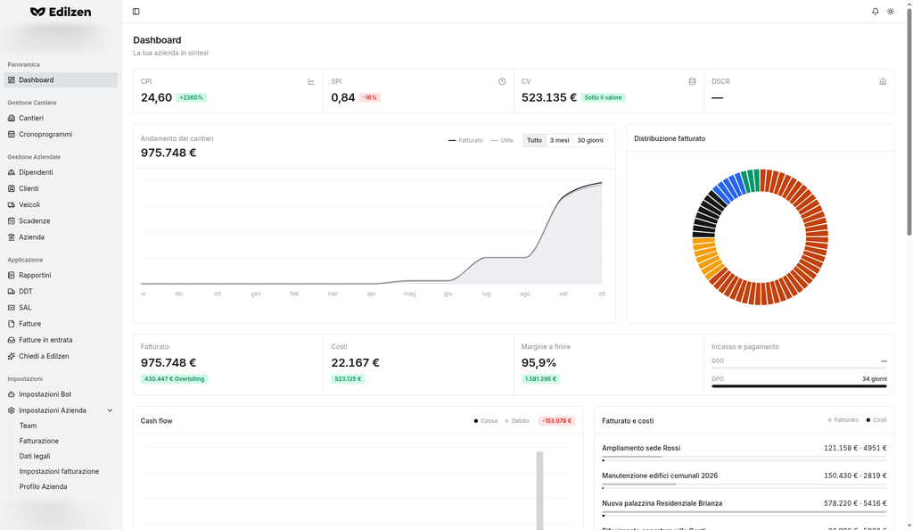

# Dashboard

**Percorso:** Panoramica › Dashboard (`/dashboard`)

La Dashboard è la pagina iniziale e riassume in un'unica schermata l'andamento economico, la fatturazione, la cassa e l'avanzamento dei cantieri attivi. Sotto il titolo si trovano i riquadri descritti di seguito, nell'ordine in cui compaiono.

## Cosa trovi in questa pagina

| Riquadro | Domanda a cui risponde |
|----------|------------------------|
| [Indicatori principali](#indicatori-principali) (CPI, SPI, CV, DSCR) | Come vanno complessivamente costi e tempi dei cantieri? |
| [Andamento dei cantieri](#fatturato-netto-anno-in-corso) | Come si sono mossi fatturato e utile nel periodo? |
| [Distribuzione fatturato](#distribuzione-fatturato) | Quanto pesa ciascun cantiere sul fatturato? |
| [Riepilogo economico](#riepilogo-economico) | Fatturato, costi, margine a finire e tempi di incasso e pagamento |
| [Cash flow](#cash-flow) | Com'è la situazione di cassa e di debito mese per mese? |
| [Fatturato e costi](#fatturato-e-costi) | Ogni cantiere attivo ha più ricavi o più costi? |
| [Posizione di fatturazione](#posizione-di-fatturazione) | Ho fatturato più o meno di quanto ho maturato con i SAL? |
| [Mappa dei cantieri](#mappa-cantieri) | Dove sono i cantieri e con quali indicatori? |
| [Ritenute](#ritenute) | Quali ritenute ho subito o applicato e quando si svincolano? |
| [Cantieri in ritardo](#cantieri-in-ritardo) | Quali cantieri sono in ritardo e di quanto? |
| [Ore per punto di SAL](#ore-per-punto-di-sal) | Quante ore servono per ogni punto percentuale di avanzamento? |

Nella Dashboard non si inseriscono dati: gli indicatori sono calcolati da Edilzen a partire dalle informazioni registrate nelle altre sezioni (cantieri, rapportini, DDT, fatture, SAL, cronoprogrammi, costi aziendali).

{ .screenshot }

## Indicatori principali

Striscia di quattro indicatori aggregati sui cantieri. Accanto a CPI e SPI compare uno scostamento in percentuale rispetto a 1 (es. *+12%* per un indice di 1,12), colorato in verde (da 1 in su), giallo (tra 0,90 e 1) o rosso (sotto 0,90).

| Indicatore | Significato | Come leggerlo |
|------------|-------------|---------------|
| **CPI** | Indice di performance dei costi: EV / AC (valore guadagnato / costo effettivo) | Sotto 1 = i costi sostenuti superano il valore guadagnato |
| **SPI** | Indice di performance dei tempi: SAL rispetto al tempo lavorativo di piano | Sotto 1 = avanzamento in ritardo rispetto al piano |
| **CV** | Scostamento dei costi (*Cost Variance*), in € | Etichetta **Sotto il valore** (verde) se i costi sono sotto il valore guadagnato, **Oltre il valore** (rosso) se lo superano |
| **DSCR** | Indice di copertura del debito (*Debt Service Coverage Ratio*) | Se il dato non è disponibile compare **—** |

Per le definizioni vedi il [Glossario](glossario.md).

## Andamento dei cantieri { #fatturato-netto-anno-in-corso }

Grafico con le linee **Fatturato** e **Utile** nel tempo. I pulsanti in alto cambiano il periodo mostrato: **Tutto**, **3 mesi**, **30 giorni**.

## Distribuzione fatturato

Grafico ad anello con la quota di ciascun cantiere. Passando il mouse su uno spicchio compaiono **Valore contratto**, **Costi** e **Fatturato ad oggi** del cantiere. Se non ci sono importi compare *"Nessun fatturato"*.

## Riepilogo economico

Quattro riquadri affiancati:

| Riquadro | Valore | Etichetta sotto il valore |
|----------|--------|---------------------------|
| **Fatturato** | Fatturato complessivo | **Underbilling** (rosso) o **Overbilling** (verde) con l'importo: differenza tra quanto maturato con i SAL e quanto fatturato (vedi [Posizione di fatturazione](#posizione-di-fatturazione)) |
| **Costi** | Costi complessivi | Il **CV** in € (verde se positivo, rosso se negativo) |
| **Margine a finire** | Margine percentuale atteso | Il **VAC** in € (valore contratto − costo stimato a finire) |
| **Incasso e pagamento** | Barre **DSO** (giorni medi di incasso dai clienti) e **DPO** (giorni medi di pagamento ai fornitori) | Differenza in giorni (*gg*): rossa se incassi più lentamente di quanto paghi, verde in caso contrario |

## Cash flow

Grafico a barre mensile con due serie: **Cassa** (barra scura) e **Debito** (barra chiara). Passando il mouse su un mese compaiono i due importi.

Il riquadro colorato accanto alla legenda riporta il **saldo netto dell'ultimo mese** (cassa al netto del debito): rosso se negativo, verde se positivo. Non coincide quindi con il solo saldo di cassa.

## Fatturato e costi

Per ogni **cantiere attivo** mostra due barre, **Fatturato** e **Costi**, con i due importi. Gli importi sono evidenziati in rosso quando i costi superano il fatturato. Se non ci sono cantieri attivi compare *"Nessun cantiere attivo"*.

## Posizione di fatturazione

Tabella per cantiere che confronta l'avanzamento con quanto fatturato:

| Colonna | Contenuto |
|---------|-----------|
| **Cantiere** | Nome, cliente e barra della percentuale di costi |
| **% costi** | Costi sostenuti in rapporto al budget (valore contratto al netto del margine target) |
| **% SAL** | Avanzamento dell'ultimo SAL |
| **Ricavi maturati** | Valore contratto × percentuale dell'ultimo SAL |
| **Fatturato** | Importo fatturato al cliente |
| **Posizione** | **Underbilling** (rosso): hai maturato più di quanto fatturato, quindi c'è lavoro da fatturare. **Overbilling** (verde): hai fatturato più di quanto maturato. **—** se le due cifre coincidono |

## Mappa dei cantieri { #mappa-cantieri }

Riquadro **Cantieri** con la mappa geografica dei cantieri. Per ogni cantiere sono indicati **CPI**, **SPI** e **Rischio** (risk score). La posizione deriva dalle coordinate (Latitudine/Longitudine) presenti nel [Profilo del cantiere](cantieri.md#profilo); senza coordinate compare *"Nessun cantiere con coordinate"*.

## Ritenute

Due riquadri affiancati, ciascuno con il totale in alto:

- **Ritenute subite** – per ogni voce: soggetto, cantiere, importo e data di scadenza;
- **Ritenute applicate** – per ogni voce: soggetto, cantiere, importo e, se mancano al massimo 60 giorni, l'indicazione *"Svincolo tra N giorni"*.

Senza dati compare *"Nessuna ritenuta registrata"*.

## Cantieri in ritardo

Tabella con **Cantiere**, **Giorni** di ritardo, **Sulla durata** (ritardo in percentuale sulla durata prevista) e **SV** (*Schedule Variance*, scostamento di programma). Se nessun cantiere è in ritardo compare *"Nessun cantiere in ritardo"*.

## Ore per punto di SAL

Per ogni cantiere: **Ore** lavorate, ore **Per punto** di SAL (ore lavorate divise per la percentuale dell'ultimo SAL, cioè le ore spese per ogni punto di avanzamento) e **Sul costo** (incidenza della manodopera sul costo totale del cantiere). Se l'incidenza della manodopera esce dalla fascia di riferimento compare l'etichetta **Sopra la fascia 18-28%** o **Sotto la fascia 18-28%**.

!!! tip "Uso consigliato"
    A inizio settimana controlla **CPI** e **SPI**, poi la **Posizione di fatturazione** (per non lasciare lavoro maturato da fatturare) e i **Cantieri in ritardo**; infine verifica **Cash flow** e tempi di **Incasso e pagamento**.
